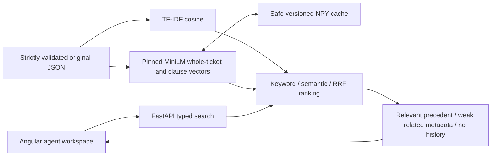

# Solari Analytics — solution design

## Problem and scope

A support agent needs useful historical precedent and its original resolution to investigate an incoming issue. Similar text is not proof that the same root cause or fix applies. This local prototype searches 40 supplied synthetic English tickets and labels **every displayed historical resolution as applicability unverified**. It generates no answers and applies no fixes.

Assumptions: one local workspace, static history, CPU-only inference, three suggestions, no real customer data/authentication. Approximately 150 incoming tickets/day does not establish concurrency or latency requirements. Customer permissions, history size, expected response time and review workflow need confirmation before deployment. Deadline: October 20, 2026 EOD, timezone unspecified; assignment expectation approximately 3–4 focused hours.

## Architecture

API validation distinguishes invalid input (422), unavailable service/capability (503), retrieved precedent, weak/conflicting related history and no relevant history (200). Synchronous handlers move blocking inference off the async event loop; the CPU model loads once, with a lock for encoding. CORS allows only documented local origins; default logs exclude incoming ticket text.

TF-IDF and MiniLM index subject+description; resolution notes remain original evidence, never retrieval-query text. Hybrid retains RRF with constant 60, stable ID ties and no contribution from zero keyword evidence. MiniLM is unchanged, pretrained, CPU-friendly and revision-pinned. Normalized historical whole-ticket/clause vectors use non-pickle NumPy caches keyed by dataset bytes, model/revision and preprocessing version. Startup validates shape/norm; revised preprocessing invalidates older cache entries. Offline reuse requires prior dependency/model provisioning.

## Focused corrections and evidence policy

The old four-word filter discarded critical short failure clauses. The splitter now keeps every nonempty fragment containing letters/digits, including short negations and symptoms, and ignores only punctuation/empty fragments. Periods inside dotted identifiers remain intact. Original stored/displayed text is unchanged. All retained clauses count toward the eight-clause limit; excess context abstains rather than approving truncation. Individual embeddings still truncate at 256 wordpieces.

Keyword mode is again useful without the model. Displaying precedent requires whole-ticket TF-IDF cosine >=0.25 and each query clause to have >=0.50 IDF-weighted meaningful-token coverage against historical clauses. Unknown tokens remain in the denominator; negation/contractions are preserved. Function-word filtering affects only this scoring feature. Keyword is conservative, not an entailment test, and never bypasses semantic/hybrid policy through the old OR gate.

Semantic/hybrid retain the existing whole-ticket/clause and shared technical-identifier heuristics, now operating on preserved short clauses. Their scores do not verify mechanism agreement either. API `historical-precedent-v1` returns original resolution notes with applicability unverified; weak/conflicting `related_history` withholds notes. Explicit keyword-only degradation remains useful, while semantic/hybrid fail with 503 if unavailable.

Angular shows the uncertainty notice beside original resolutions, separate related-history details, no-history/loading/error states, examples, accessible labels and responsive layout. AbortController plus a sequence guard protects edits/reset/new requests from stale results.

## Data quality, compatibility and limits

Required fields/types and duplicate IDs fail validation. Duplicate subject+description content is separately inspected using whitespace/casefold only and reported without deleting legitimate repeated incidents. No imputation or outlier model is appropriate; preserve negation, error codes, IDs and original data.

Backend tests ran on actual Windows Python 3.10.11 and 3.11.9, not original Launchpad 3.10.0. Angular requires additional project-local Node 22.23.2 because supplied Node 20.10.0 is incompatible. Existing checksum bootstrap leaves system runtimes intact. Preflight checks versions/dependencies, real embeddings, HTTP readiness/capabilities and frontend build; actual sandbox restrictions remain manual verification.

All previous evaluation artifacts are preserved, but previous release/inspected cases are now exposed regressions. Current metrics measure displayed unverified precedent relevance, not the old supported-resolution definition. Real-model tests confirm the short missing-email clause changes retrieval; this does not prove general correctness. Keyword recalls only 2/8 original and 3/8 previous-release positives, illustrating the cost of conservative lexical context. No thresholds were tuned until every example passed. One short login-failure regression also displays an irrelevant extra precedent despite retrieving the correct one. AI-authored synthetic labels still need independent agent review.

JSON/in-memory indexes avoid infrastructure but require restart on data changes. Real deployment requires authentication, tenant isolation, access-filtered indexes, retention controls, representative labels and realistic load tests. More data/budget should first fund relevance feedback, robust mechanism/negation evaluation and measured abstention, not speculative databases, new models or generation. See evaluation/validation docs for actual commands, failures and limitations.
