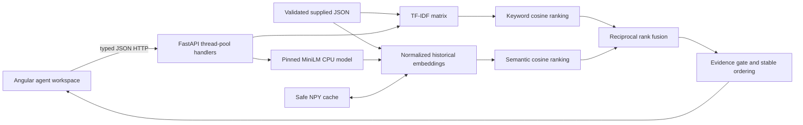

# Solari Analytics — solution design

## Problem and assumptions

Support agents need relevant precedent and the original resolution, so they can investigate efficiently and avoid inconsistent advice. This prototype searches 40 supplied synthetic historical tickets using an incoming subject and description. Similarity means the same observable issue or a closely related failure mechanism, rather than simply the same product category. A retrieved resolution is evidence for an agent to review, never an automatically generated fix.

Assumptions: English text; one local support workspace; static history; CPU inference; no authentication or real customer data; three suggestions by default. Approximately 150 incoming tickets/day does not by itself specify concurrency or history size. Warm interactive latency is measured locally, with no production SLA claim. Customers must confirm their latency target, permission model, history size, taxonomy, and feedback process before deployment. The deadline is October 20, 2026 EOD; its timezone remains unspecified. The assignment expects about 3–4 focused hours and prioritizes a complete, small core flow.

## Architecture

The API validates every historical record and fails startup on malformed data or duplicate IDs. It indexes subject plus description, keeping original resolutions out of retrieval queries and evaluation inputs. TF-IDF uses word unigrams/bigrams and preserves technical tokens/numbers. ID order breaks score ties deterministically. Zero-evidence keyword candidates receive no fusion rank.

MiniLM is small, pretrained, and CPU-friendly. The exact model repository revision is pinned in `backend/retrieval.py`. It is loaded once, with normalized historical embeddings reused from a non-pickle NumPy cache. Dataset bytes, model ID/revision, and preprocessing version determine the cache key. Query and historical text use the same layout. MiniLM truncates at 256 wordpieces: long tickets can lose context, so production would need chunking or field-aware truncation. Model download is an explicit prerequisite; offline reuse is supported after pre-download.

Hybrid uses RRF with rank constant 60, not a sum of incompatible raw similarities. A per-candidate evidence gate suppresses weak suggestions. Thresholds are heuristic values reviewed against development examples only; cosine and RRF values are not probabilities. Scores remain inspectable in an optional details view. Evaluation explains strict relevance labels and observed trade-offs rather than assuming hybrid wins.

Model failure leaves keyword search available with an explicit degraded indicator. Semantic/hybrid requests return 503; they never silently turn into keyword searches. The UI selects keyword when readiness reports degradation. Invalid input (422), unavailable service (503), and successful no-match (200) are separate outcomes. Blocking inference runs in synchronous FastAPI handlers off the async event loop; a model lock limits simultaneous encoding on this small CPU application.

Angular provides a restrained, responsive workspace with examples, original resolution notes, descriptions, tags, loading, errors, and no-match states. AbortController and a request-generation guard prevent older responses from replacing new searches or reset state. A local dev proxy keeps API requests on the same frontend origin. CORS allows only the two documented local development origins.

## Trade-offs and next investment

JSON and in-memory indexes fit 40 tickets and make the case reproducible without infrastructure. They require restart on data changes and do not implement concurrent index updates or distributed search. TF-IDF gives inspectable exact-term matches; embeddings handle paraphrases but can confuse topical similarity with issue equivalence. RRF is scale-independent but can promote weak lexical neighbors; the gate trades recall for fewer misleading resolutions. See `evaluation/README.md` for measured comparisons and limitations.

The synthetic, AI-assisted labeled evaluation is intentionally small and is not evidence of production accuracy, throughput, or calibrated abstention. Real agents should independently label representative queries, including ambiguous cases and unseen integrations, then tune using a separate development set and audit held-out errors. Next investments would be relevance feedback, better abstention, field-aware embeddings, access-filtered indexing, monitoring and load tests. Real customer permissions, tenant isolation, retention controls, authentication and redacted observability are required before using private data; supplied tickets have no tenant identifiers. No model training, database, paid service, or generative LLM is justified for this prototype.
