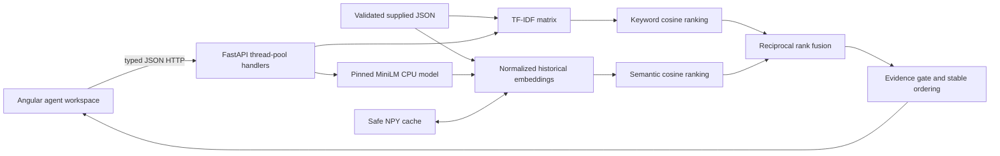

# Solari Analytics — solution design

## Problem and assumptions

Support agents need relevant precedent and the original resolution, so they can investigate efficiently and avoid inconsistent advice. This prototype searches 40 supplied synthetic historical tickets using an incoming subject and description. Similarity means the same observable issue or a closely related failure mechanism, rather than simply the same product category. A retrieved resolution is evidence for an agent to review, never an automatically generated fix.

Assumptions: English text; one local support workspace; static history; CPU inference; no authentication or real customer data; three suggestions by default. Approximately 150 incoming tickets/day does not by itself specify concurrency or history size. Warm interactive latency is measured locally, with no production SLA claim. Customers must confirm their latency target, permission model, history size, taxonomy, and feedback process before deployment. The deadline is October 20, 2026 EOD; its timezone remains unspecified. The assignment expects about 3–4 focused hours and prioritizes a complete, small core flow.

## Architecture

The API validates every historical record and fails startup on malformed data or duplicate IDs. It indexes subject plus description, keeping original resolutions out of retrieval queries and evaluation inputs. TF-IDF uses word unigrams/bigrams and preserves technical tokens/numbers. ID order breaks score ties deterministically. Zero-evidence keyword candidates receive no fusion rank.

MiniLM is small, pretrained, and CPU-friendly. The exact model repository revision is pinned in `backend/retrieval.py`. It is loaded once, with normalized historical whole-ticket and clause embeddings reused from a non-pickle NumPy cache. Dataset bytes, model ID/revision, and preprocessing version determine the cache key; revised clause layout invalidates earlier caches. MiniLM truncates at 256 wordpieces, so long individual clauses still lose context. Model download is an explicit prerequisite; offline reuse is supported after pre-download.

Hybrid retains RRF with rank constant 60, not a sum of incompatible raw similarities. The reviewed keyword-OR-semantic gate confused topical similarity with symptom evidence. The revised policy first ranks candidates, then distinguishes **supported history** from **potentially related context**. Topic similarity alone cannot display a resolution: related results contain metadata without resolution notes. Keyword-only search deliberately offers only this context, including in degraded mode; its zero supported recall is a feature restriction, not proof of better retrieval.

Support requires overall cosine ≥0.65 and each retained description clause to match some candidate subject/description clause at ≥0.45. A generic shared ≥3-digit technical identifier can alternatively corroborate a result when overall and identifier-clause cosines are both ≥0.60, preserving explicit HTTP-error matches despite poorly aligned incidental wording. Generic English clause splitting uses no product names, ticket IDs or example strings; short fragments below four words are discarded, with whole-text fallback. More than eight query clauses causes abstention rather than approval of truncated context. These are explainable heuristics, not entailment or calibrated probabilities. A clause can still have similar words and a different mechanism; negation, short fragments and shared numeric identifiers remain risks.

Model failure leaves keyword search available with an explicit degraded indicator. Semantic/hybrid requests return 503; they never silently turn into keyword searches. The UI selects keyword when readiness reports degradation. Invalid input (422), unavailable service (503), and successful no-match (200) are separate outcomes. Blocking inference runs in synchronous FastAPI handlers off the async event loop; a model lock limits simultaneous encoding on this small CPU application.

Angular provides a restrained, responsive workspace with examples, original resolution notes, descriptions, tags, loading, errors, and no-match states. AbortController and a request-generation guard prevent older responses from replacing new searches or reset state. A local dev proxy keeps API requests on the same frontend origin. CORS allows only the two documented local development origins.

## Trade-offs and next investment

JSON and in-memory indexes fit 40 tickets and make the case reproducible without infrastructure. They require restart on data changes and do not implement concurrent index updates or distributed search. TF-IDF gives inspectable exact-term matches; embeddings handle paraphrases but can confuse topical similarity with issue equivalence. RRF is scale-independent but can promote weak lexical neighbors; the gate trades recall for fewer misleading resolutions. See `evaluation/README.md` for measured comparisons and limitations.

Backend installation, real inference and tests passed on actual Windows Python 3.10.11 and 3.11.9. This is not original Launchpad/Python 3.10.0 validation. Angular 20.3 still requires an additional compatible Node runtime; the existing checksum-verified project-local Node 22.23.2 bootstrap leaves the system Node untouched. Windows preflight verifies dependencies, real embedding generation, HTTP readiness/capabilities and frontend build; Launchpad policy/network restrictions still require manual verification there.

Original evaluation artifacts are preserved. The old held-out cases are now exposed regression evidence. Intermediate fresh sets also became exposed during iteration; final release cases and policy hashes were frozen before final scoring. Regression hybrid false acceptances improve 2→0 with Recall@3/MRR retained at 1.0; frozen release results improve 2→0 with Recall@3/MRR retained at .875, one false rejection, and greater warm latency. Development loses some supported multi-issue recall, and broad paraphrases can remain related-only. Earlier newly worded missing-mail and SMS-recovery cases still illustrate false acceptance risks. See `evaluation/README.md` for per-mode counts, latency and provenance. No policy tuning followed release outcomes.

AI-authored synthetic labels are not independent human review or evidence of production accuracy, throughput, or calibrated abstention. Real agents should label representative queries before further tuning. Next investments: relevance feedback, better abstention, access-filtered indexing, monitoring and load tests. Real customer permissions, tenant isolation, retention controls, authentication and redacted observability are required before private data use; supplied tickets have no tenant identifiers. No training, database, paid service, or generative LLM is justified here.
