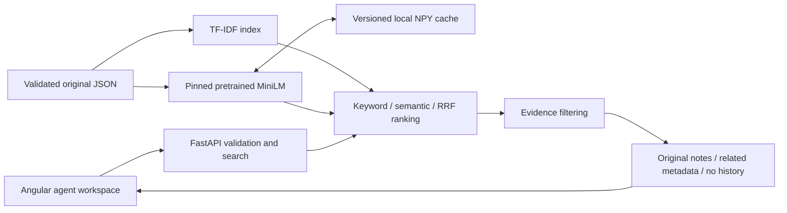

# Solari Ticket Assistant — solution design

## Problem and assumptions

Solari's agents can waste investigation time rediscovering earlier solutions and give inconsistent answers to customers with similar issues. The assistant makes prior incidents and original resolution notes easier to find. Similarity is useful precedent, not proof that two incidents have the same cause; **applicability remains unverified** and the agent decides what applies.

This prototype assumes one local agent workspace, English text, static supplied synthetic history and CPU-only inference. Those choices make the core workflow runnable without service accounts or infrastructure. The 40 supplied tickets provide a reproducible starting point, not a representative production corpus. Three results are the default to keep review manageable; the API permits up to ten. No incoming customer ticket is stored. The stated roughly 150 new tickets per day does not establish peak concurrency, future history size or a latency target. Those requirements, data permissions and the review workflow need customer confirmation.

## Architecture and implementation

Angular/TypeScript provides subject/description input, mode selection, examples and separate loading, result, no-history and failure states. Cancellation plus a sequence guard suppress stale responses. FastAPI validates input and runs synchronous CPU search outside the async event loop. The model loads once; encoding is locked. Readiness reports actual capabilities. Validation errors (422) and unavailable capability/service (503) are distinct from a successful search without relevant history.

TF-IDF cosine retrieves literal terms and identifiers cheaply. Pretrained `all-MiniLM-L6-v2`, pinned to revision `1110a243fdf4706b3f48f1d95db1a4f5529b4d41`, supplies normalized 384-dimensional whole-ticket and clause embeddings without training or paid inference. Hybrid ranking uses reciprocal rank fusion (RRF, constant 60), avoiding direct addition of differently scaled scores. Ties are deterministic. Indexes use subject and description; resolution notes do not influence ranking. Safe non-pickle NPY caches include data, model and preprocessing versions and are checked for shape and normalization.

## Evidence and data quality

Every alphanumeric clause survives splitting, including short failures and negation. Dots/hyphens inside technical identifiers are preserved. Query scoring removes limited generic polite request framing while retaining its objects, symptoms and identifiers; original history and displayed notes are unchanged. Required fields/types and duplicate IDs fail validation. Duplicate content is flagged with minimal whitespace/case normalization for inspection, never automatically removed; repeated incidents may be legitimate. There is no imputation or outlier removal.

Keyword notes require overall cosine >=.25 and every clause's IDF-weighted lexical coverage >=.50, with unknown terms retained in the denominator. Semantic/hybrid notes require overall similarity >=.65 and minimum clause alignment >=.45, or the existing corroborated technical-identifier route (>=.60). A short-query route (2–12 distinct meaningful tokens) requires keyword >=.25, overall semantic >=.60, every clause >=.65 and lexical coverage >=.50. These are conjunctive relevance heuristics, not calibrated confidence or contradiction detection. Excess context beyond eight clauses abstains; each embedding still truncates at 256 wordpieces.

A qualifying result shows **original resolution notes with applicability unverified**. Weak/conflicting candidates provide related metadata without notes; no relevant history is explicit. No fixes are generated or applied. Explicit keyword-only degradation can still show useful precedent, while unavailable semantic/hybrid requests return 503.

## Trade-offs, measurements and future work

The four supplied hybrid examples show chart and duplicate-billing notes while withholding misleading reset-email and unfamiliar-integration notes. On eight exposed informal positives, hybrid Recall@3/MRR improved .625 to .875; none of ten confusing negatives displayed notes. Keyword recall there is .375. One informal 429 paraphrase still abstains, and an older login example includes an irrelevant extra result. These small AI-authored synthetic labels are not independent evaluation or production accuracy evidence. See the evaluation and validation documents for exact inputs, definitions, scores and actual checks.

JSON and in-memory indexes keep the demo simple but require restart for history changes. A persistent/vector store decision should follow update/persistence needs, access filtering, memory use and measured latency under representative load, not an arbitrary ticket-count threshold. With more time/data, prioritize independently reviewed relevance labels, mechanism/negation evaluation and agent workflow feedback. Production work would require authentication, tenant isolation, retention controls, deployment monitoring and measured load targets. New ingestion, persisted feedback and additional models remain out of scope.
